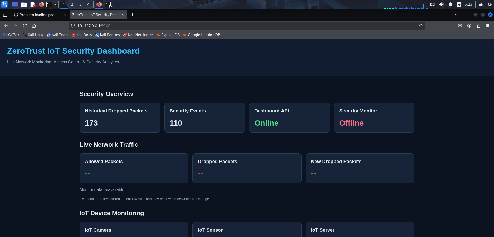
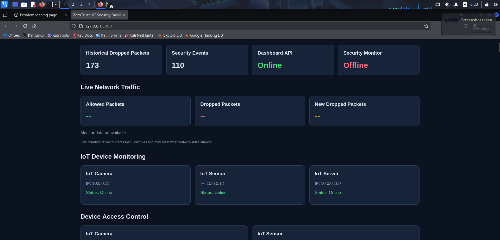
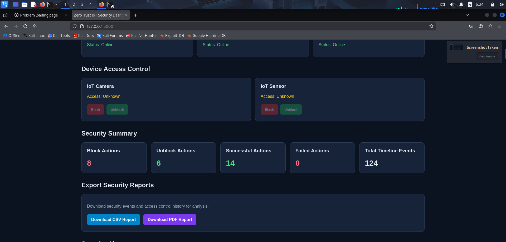
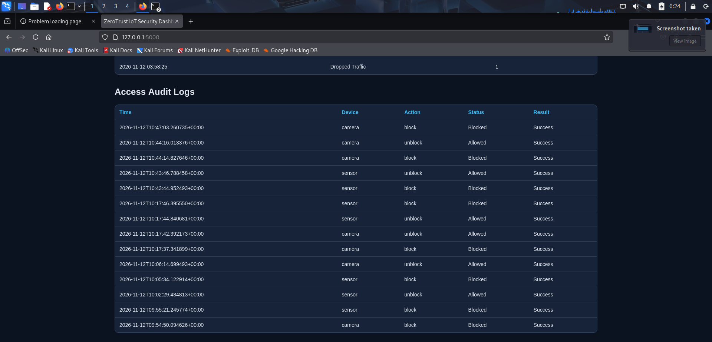
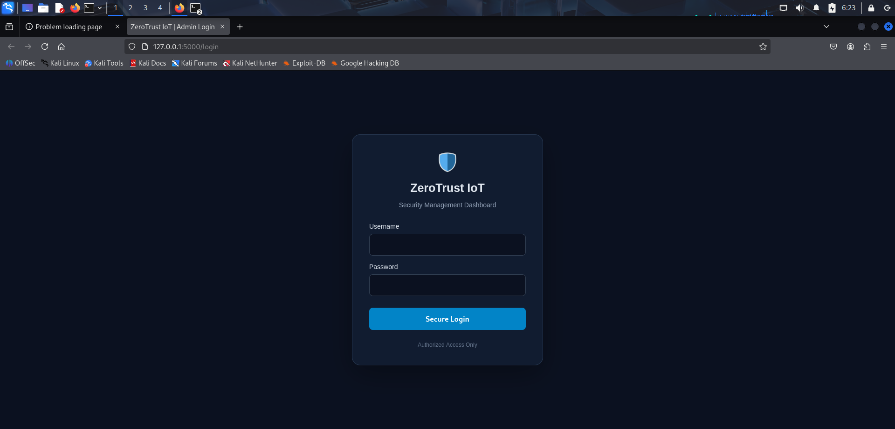

# ZeroTrust-IoT

### Zero Trust Network Security Framework for IoT Devices

ZeroTrust-IoT is a cybersecurity graduation project that demonstrates how Zero Trust security principles can be applied to Internet of Things (IoT) networks.

The project uses Mininet, Open vSwitch, OpenFlow 1.3, Python, and Flask to simulate an IoT environment with centralized access control, traffic monitoring, and security auditing.

## Features

- Simulated IoT network using Mininet
- OpenFlow 1.3 security policies
- Default-deny network access policy
- Device-level Block and Unblock controls
- IoT Camera and IoT Sensor isolation
- Web-based security dashboard
- Administrator authentication
- CSRF protection
- Network traffic monitoring
- Security event logging
- Access control audit history
- PDF and CSV report generation

## Network Architecture

```text
                ZeroTrust-IoT
                      |
               Flask Dashboard
                      |
              Access Control
                      |
              Open vSwitch (s1)
                 /    |    \
                /     |     \
           Camera   Sensor   Server
          10.0.0.11 10.0.0.12 10.0.0.100
```

### Network Devices

| Device | IP Address | Role |
|--------|------------|------|
| IoT Camera | 10.0.0.11 | Simulated IoT device |
| IoT Sensor | 10.0.0.12 | Simulated IoT device |
| IoT Server | 10.0.0.100 | Protected destination |
| Open vSwitch | s1 | OpenFlow-enabled switch |

## Technologies

- Python 3
- Flask
- Mininet
- Open vSwitch
- OpenFlow 1.3
- HTML, CSS and JavaScript
- Linux / Kali Linux

## Installation

### 1. Clone the repository

```bash
git clone https://github.com/YOUR_USERNAME/ZeroTrust-IoT.git
cd ZeroTrust-IoT
```

Replace `YOUR_USERNAME` with your GitHub username.

### 2. Install system dependencies

On Kali Linux:

```bash
sudo apt update
sudo apt install -y mininet openvswitch-switch python3 python3-venv
```

### 3. Install Python dependencies

```bash
python3 -m venv --system-site-packages .venv
source .venv/bin/activate
pip install -r requirements.txt
```

### 4. Configure local authentication

The dashboard requires local authentication configuration.

The administrator password hash and Flask secret key must be created locally before starting the dashboard.

Never commit authentication secrets, password hashes, or private keys to GitHub.

### 5. Configure privileged helpers

The access control and device monitoring helpers require restricted sudo permissions.

Configure these helpers before using the dashboard's privileged controls.

Do not run the Flask dashboard as root.

## Running the Project

Open separate terminals for the following components.

### Terminal 1: Start the IoT Network

```bash
cd ZeroTrust-IoT
sudo python3 network/iot_lab.py
```

The Mininet CLI will appear:

```text
mininet>
```

### Terminal 2: Start Traffic Monitoring

```bash
cd ZeroTrust-IoT
sudo python3 network/monitor.py
```

### Terminal 3: Start the Dashboard

```bash
cd ZeroTrust-IoT
source .venv/bin/activate
python3 dashboard/app.py
```

Open the dashboard in your browser:

http://127.0.0.1:5000

## Testing Network Connectivity

Inside the Mininet CLI:

```bash
camera ping -c 5 server
sensor ping -c 5 server
```

Both devices should communicate with the server when their access is allowed.

## Testing Zero Trust Access Control

1. Open the dashboard.
2. Log in as the administrator.
3. Select the IoT Camera.
4. Click Block.
5. Run the following command inside Mininet:

```bash
camera ping -c 5 server
```

Expected result:

```text
100% packet loss
```

6. Click Unblock.
7. Repeat the ping test.

Expected result:

```text
0% packet loss
```

## Inspecting OpenFlow Rules

Run:

```bash
sudo ovs-ofctl -O OpenFlow13 dump-flows s1
```

The project uses:

| Priority | Purpose |
|----------|---------|
| 300 | Device blocking rules |
| 200 | Allowed ICMP communication |
| 100 | ARP communication |
| 0 | Default drop |

## Security Design

The project demonstrates several Zero Trust concepts:

- Explicit network access policies
- Default-deny traffic handling
- Device-specific network isolation
- Centralized access management
- Monitoring and auditing
- Protected administrative operations

This is an educational prototype and is not intended to be deployed as a production security gateway without additional hardening.

## Project Structure

```text
ZeroTrust-IoT/
├── dashboard/
│   ├── app.py
│   ├── auth.py
│   └── templates/
│       ├── index.html
│       └── login.html
├── network/
│   ├── access_control.py
│   ├── device_monitor.py
│   ├── iot_lab.py
│   └── monitor.py
├── docs/
│   └── screenshots/
├── logs/
├── .gitignore
├── requirements.txt
└── README.md
```

## Future Improvements

- Role-based access control
- Device identity verification
- Additional IoT device types
- Automated security policy enforcement
- Advanced traffic analysis
- Automated testing and CI/CD

## Disclaimer

This project is intended for educational and authorized cybersecurity research only.

## Author

Cybersecurity Graduation Project

---

## Quick Start — Kali Linux

### Prerequisites

This project is designed for a Linux environment with Mininet
and Open vSwitch installed.

Install the system packages:

```bash
sudo apt update
sudo apt install -y \
  mininet \
  openvswitch-switch \
  python3 \
  python3-venv \
  python3-reportlab \
  sudo
```

Start Open vSwitch:

```bash
sudo systemctl enable --now openvswitch-switch
```

### Clone and install

```bash
git clone https://github.com/zyousri50-crypto/ZeroTrust-IoT.git
cd ZeroTrust-IoT

python3 -m venv --system-site-packages .venv
source .venv/bin/activate

pip install -r requirements.txt
```

### Configure administrator authentication

On a fresh installation, run:

```bash
python3 setup_admin.py
```

Choose an administrator password when prompted.

Default username:

```text
admin
```

Authentication credentials are stored locally in
`dashboard/instance/` and excluded from Git.

Do not commit passwords, password hashes, or secret keys.

### Configure privileged helpers

The dashboard uses restricted privileged helpers to inspect
the simulated network and manage device access.

Review the installation script before running it:

```bash
cat scripts/setup_helpers.sh
```

Then install the helpers:

```bash
sudo bash scripts/setup_helpers.sh
```

This installs root-owned helper copies and restricted sudo rules.

Only run this script on a trusted Kali Linux machine.

### Run the project

Open three terminals.

**Terminal 1 — IoT network**

```bash
cd ~/ZeroTrust-IoT
sudo python3 network/iot_lab.py
```

Keep the Mininet CLI running.

**Terminal 2 — Traffic monitor**

```bash
cd ~/ZeroTrust-IoT
sudo python3 network/monitor.py
```

**Terminal 3 — Web dashboard**

```bash
cd ~/ZeroTrust-IoT
source .venv/bin/activate
python3 dashboard/app.py
```

Open:

http://127.0.0.1:5000

Sign in using username `admin` and the password
created during setup.

### Verify the installation

Inside the Mininet CLI:

```bash
camera ping -c 5 server
sensor ping -c 5 server
```

Check OpenFlow rules in a separate terminal:

```bash
sudo ovs-ofctl -O OpenFlow13 dump-flows s1
```

Check device access status:

```bash
sudo -n /usr/bin/python3 \
  /usr/local/sbin/zerotrust-access-v2 status camera
```

Check device monitoring:

```bash
sudo -n /usr/bin/python3 \
  /usr/local/sbin/zerotrust-device-monitor
```

### Troubleshooting

**Dashboard reports missing authentication files**

Run `python3 setup_admin.py` on a fresh installation.
If credentials already exist, do not overwrite them blindly.

**Device status displays Unknown**

Verify that Mininet is running and that the privileged
device monitor helper is installed and authorized.

**Access control returns an error**

Check that Open vSwitch is running, switch `s1` exists,
and the restricted helper installation succeeded.

**Port 5000 is unavailable**

Check whether another process is using port 5000.

### Security Notes

- The dashboard is intended for localhost access.
- Never expose the Flask development server directly to the internet.
- Privileged helper installation requires administrator approval.
- The project is an educational security prototype.

---

## Dashboard Screenshots

### Dashboard Overview



### Device Monitoring



### Device Access Control



### Security Logs



### Administrator Login



